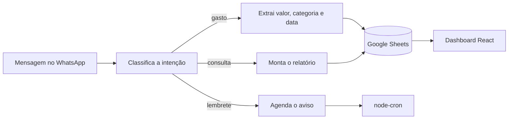

# Alfred

Assistente financeiro pessoal que funciona dentro do WhatsApp. Você manda "gastei 50 no almoço" e ele entende, categoriza e registra. Depois é só perguntar "quanto gastei esse mês?" ou abrir o dashboard.

Feito por Linyker Mendes e Felipe Gandour.

## Como funciona



1. A mensagem chega pelo WhatsApp (Baileys).
2. Um modelo rápido classifica a intenção: gasto, consulta, lembrete, correção ou outro.
3. Para gastos, um modelo maior extrai os dados em JSON (valor, categoria, data, descrição). Se o JSON vier inválido, a mensagem é descartada com log em vez de gravar lixo.
4. Os lançamentos ficam em uma planilha do Google Sheets, que o próprio usuário pode abrir.
5. O dashboard mostra resumo, gastos por categoria, tendência e orçamento. O login é por código enviado no próprio WhatsApp, válido por 5 minutos.

## Stack

- **Backend:** Node.js 22, Express
- **LLM:** Groq (Llama 3.1 8B para classificar, Llama 3.3 70B para extrair e gerar relatórios)
- **WhatsApp:** Baileys
- **Dados:** Google Sheets API
- **Agendamento:** node-cron
- **Dashboard:** React, Vite
- **Deploy:** Railway

## Decisões

- **Dois modelos em vez de um.** Classificar a intenção é uma tarefa simples e acontece em toda mensagem, então usa o modelo pequeno. Só a extração e o relatório pagam pelo modelo maior.
- **Saída em JSON validada.** O modelo nunca escreve direto na planilha: a resposta é convertida e conferida antes.
- **Google Sheets como banco.** Sem infraestrutura para manter, e o usuário continua dono dos próprios dados.
- **Twilio para Baileys.** A primeira versão usava a API do Twilio. Migrei para o Baileys, que é gratuito.

Mais contexto em [`docs/DECISIONS.md`](docs/DECISIONS.md) e [`docs/alfred-arquitetura.md`](docs/alfred-arquitetura.md).

## Rodando

```bash
npm install
cp .env.example .env   # preencha as chaves e adicione GROQ_API_KEY
npm run build          # gera o dashboard
npm start
```

Na primeira execução, abra `/qr` para conectar o número do WhatsApp que vai ser o bot. `GET /health` informa se a sessão está conectada.

## Estrutura

```
src/
├── server.js        # Express, pareamento do WhatsApp e arquivos do dashboard
├── handlers/        # gasto, consulta, lembrete e roteamento por intenção
├── prompts/         # prompts de classificação, extração, relatório e lembrete
├── services/        # LLM, WhatsApp, Sheets, autenticação e agendador
└── routes/          # API do dashboard
dashboard/           # app React
docs/                # visão, arquitetura, user stories e decisões
```
